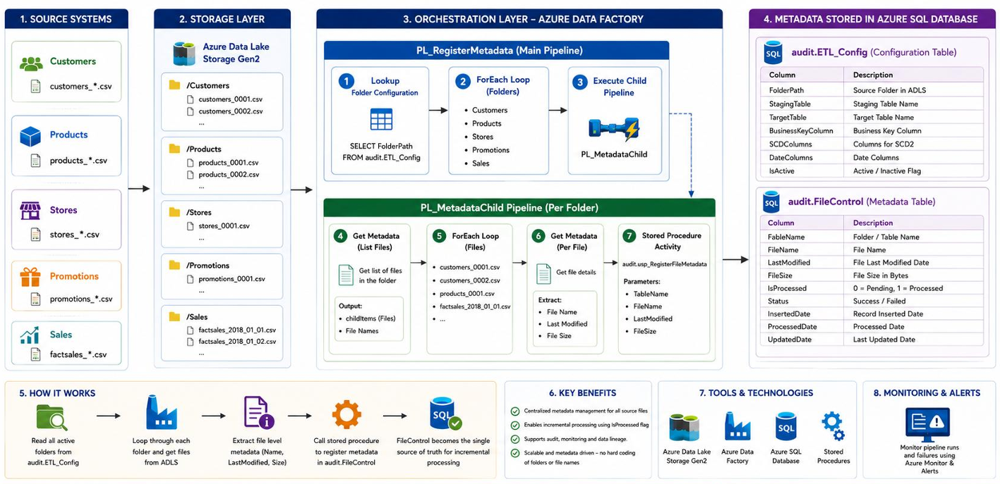

# 🚀 Automated File Metadata Registration Framework

### Using Azure Data Factory, Azure Data Lake Storage Gen2 & Azure SQL Database

---

## 📌 1. Project Overview

The **Automated File Metadata Registration Framework** is an Azure-based data engineering solution designed to automate the discovery, extraction, and registration of file-level metadata from multiple source systems.

The framework uses **Azure Data Factory (ADF)** to scan folders and files stored in **Azure Data Lake Storage Gen2 (ADLS Gen2)**, extract relevant metadata, and register the information in a centralized **Azure SQL Database**.

The collected metadata includes:

- File Name
- File Size
- Last Modified Date
- Folder / Table Name
- Processing Status
- Registration and Processing Dates

The main objective is to establish a centralized and automated metadata management framework that improves data visibility, traceability, monitoring, and control over the organization's data ingestion process.

---

## 🎯 2. Business Objectives

The main objectives of this project are:

- **Centralized Metadata Management:** Maintain a single repository containing metadata about files received from different source systems.
- **Automated File Discovery:** Automatically discover files across configured folders in Azure Data Lake Storage Gen2.
- **File Monitoring:** Track file names, sizes, modification timestamps, and processing statuses.
- **Incremental Processing:** Identify previously registered or processed files to support incremental processing.
- **Data Traceability:** Maintain historical information about file registration and processing activities.
- **Scalability:** Support the addition of new source folders through configuration rather than hardcoded pipeline logic.
- **Operational Visibility:** Provide a foundation for monitoring file ingestion and identifying missing, failed, or unexpected files.

---

## 🏗️ 3. Solution Architecture

The solution consists of four main architectural layers:

1. **Source Systems**
2. **Storage Layer – Azure Data Lake Storage Gen2**
3. **Orchestration Layer – Azure Data Factory**
4. **Metadata Repository – Azure SQL Database**

### Architecture Diagram



---

## 📂 4. Source Systems

The framework is designed to collect files originating from multiple business domains.

| Source System | Example File |
|---|---|
| Customers | `customers_0001.csv` |
| Products | `products_0001.csv` |
| Stores | `stores_0001.csv` |

Each source system has its own folder in Azure Data Lake Storage Gen2.

---

## ☁️ 5. Storage Layer – Azure Data Lake Storage Gen2

Azure Data Lake Storage Gen2 acts as the centralized storage layer for incoming source files.

### Folder Structure

```text
/
├── Customers/
│   ├── customers_0001.csv
│   └── customers_0002.csv
│
├── Products/
│   ├── products_0001.csv
│   └── products_0002.csv
│
├── Stores/
│   └── stores_0001.csv
│
├── Promotions/
│   └── promotions_0001.csv
│
└── Sales/
    ├── factsales_2018_01_01.csv
    └── factsales_2018_01_02.csv
```

This organization allows the framework to discover and process files according to their respective source folders.

---

## ⚙️ 6. Azure Data Factory – Orchestration Layer

Azure Data Factory (ADF) is the orchestration engine responsible for coordinating the metadata registration and data loading processes.

The solution consists of two interconnected workflows:

1. **Metadata Registration Workflow:** Discovers files stored in Azure Data Lake Storage Gen2, extracts their metadata, and registers the information in Azure SQL Database.
2. **Data Loading Workflow:** Uses the registered file information to identify and load source files into SQL staging tables, followed by Slowly Changing Dimension Type 2 (SCD Type 2) processing.

The Metadata Registration Workflow is designed to execute before the Data Loading Workflow because the latter retrieves file information from the centralized metadata repository.

---

### 6.1 Metadata Registration Workflow

The Metadata Registration Workflow is responsible for automatically discovering files across configured source folders, extracting their properties, and registering the metadata in Azure SQL Database.

It consists of two pipelines:

- `PL_RegisterMetadata` – Main Pipeline
- `PL_MetadataChild` – Child Pipeline

#### A. Main Pipeline – PL_RegisterMetadata

The main pipeline coordinates metadata registration across the configured source folders.

**Pipeline Activities:**

| Activity | Description |
|---|---|
| Lookup – Folder Configuration | Retrieves active folder configurations from `audit.ETL_Config`. |
| ForEach – Folders | Iterates through the configured source folders. |
| Execute Child Pipeline | Executes `PL_MetadataChild` for each folder and passes the relevant folder information. |

**Execution Logic:**

1. Retrieve active folder paths from `audit.ETL_Config`.
2. Iterate through the configured source folders.
3. Execute the metadata child pipeline for each folder.
4. Pass the folder configuration to the child pipeline.

#### B. Child Pipeline – PL_MetadataChild

The child pipeline performs file discovery and metadata extraction for each configured folder.

**Pipeline Activities:**

| Activity | Description |
|---|---|
| Get Metadata – List Files | Retrieves the list of files available in the selected ADLS Gen2 folder. |
| ForEach – Files | Iterates through the discovered files. |
| Get Metadata – File Properties | Extracts individual file properties. |
| Stored Procedure Activity | Executes `audit.usp_RegisterFileMetadata` to register the extracted metadata in Azure SQL Database. |

**Metadata Extracted:**

- File Name
- Last Modified Timestamp
- File Size (Bytes)

**Execution Logic:**

1. Retrieve the list of files from the configured source folder.
2. Iterate through the discovered files.
3. Extract the file name, last modified timestamp, and file size.
4. Pass the extracted metadata to the SQL stored procedure.
5. Register the metadata in `audit.FileControl`.

**Output:** A centralized inventory of registered source files in Azure SQL Database.

---

### 6.2 Data Loading Workflow

Once the metadata registration process has populated `audit.FileControl`, the Data Loading Workflow uses the registered file information to drive the ingestion process.

It consists of two pipelines:

- `PL_LoadData_Master` – Master Pipeline
- `PL_LoadDataChild` – Child Pipeline

#### A. Master Pipeline – PL_LoadData_Master

The master pipeline orchestrates the loading of source files from ADLS Gen2 into their corresponding SQL staging and target tables.

It dynamically retrieves the required folder and table configurations from `audit.ETL_Config`.

**Pipeline Activities:**

| Activity | Description |
|---|---|
| GetTableInfo (Lookup) | Retrieves active folder configurations, including FolderPath, StagingTable, and TargetTable. The current query excludes the Sales folder. |
| LoopInFolders (ForEach) | Iterates sequentially through the configured source folders. |
| SetFolderPath | Stores the current folder path in the `FolderPath` variable. |
| SetStagingTable | Stores the corresponding staging table name in the `StagingTable` variable. |
| SetTableName | Stores the corresponding target table name in the `Tablename` variable. |
| TruncateStagingAndFinalTables | Executes `stg.usp_TruncateTable` with the staging and target table names. |
| ExecuteChild | Invokes `PL_LoadDataChild`, passing the folder name and staging table name as parameters. |

**Execution Logic:**

1. Retrieve active folder configurations from `audit.ETL_Config`.
2. Exclude the Sales folder according to the current Lookup query.
3. Iterate through the configured folders sequentially.
4. Assign the folder path, staging table, and target table to pipeline variables.
5. Execute `stg.usp_TruncateTable` to prepare the corresponding tables.
6. Invoke `PL_LoadDataChild`.
7. Pass the source folder and staging table information to the child pipeline.

#### B. Child Pipeline – PL_LoadDataChild

The child pipeline is responsible for retrieving registered file names, loading the corresponding CSV files into SQL staging tables, and executing the SCD Type 2 transformation process.

**Pipeline Activities:**

| Activity | Description |
|---|---|
| GetFileInfo (Lookup) | Retrieves file names from `audit.FileControl` for the specified folder. |
| LoopInFiles (ForEach) | Iterates sequentially through the retrieved file names. |
| SetFileName | Stores the current file name in the `FileName` variable. |
| CopyFromADLSToStaging (Copy Data) | Copies the selected CSV file from ADLS Gen2 into the corresponding SQL staging table. |
| RunSCD2 (Stored Procedure) | Executes `dw.usp_SCD2_Generic` after all file-loading activities complete successfully. |

**Execution Logic:**

1. Retrieve file names from `audit.FileControl` using the specified folder name.
2. Iterate through the retrieved files sequentially.
3. Assign the current file name to the `FileName` variable.
4. Read the corresponding CSV file from ADLS Gen2.
5. Add the source file name as an additional column using the `$$FILENAME` value.
6. Copy the file contents into the configured SQL staging table.
7. After all files have been loaded successfully, execute `dw.usp_SCD2_Generic`.
8. Pass the staging table name to the stored procedure for SCD Type 2 processing.

**Data Movement:**

`Azure Data Lake Storage Gen2 → SQL Staging Tables → SQL Target Tables`

---

### 6.3 Relationship Between Both Workflows

The Metadata Registration and Data Loading workflows are interconnected through the `audit.FileControl` table.

The Metadata Registration Workflow creates the centralized inventory of available source files, while the Data Loading Workflow consumes this information to identify which files should be loaded.

---

## 🗄️ 7. Azure SQL Database – Metadata Repository

Azure SQL Database provides centralized storage for configuration and file registration metadata.

The framework uses two main tables.

### 7.1 Configuration Table – audit.ETL_Config

This table defines the source folder configurations used by the metadata registration framework.

| Column | Description |
|---|---|
| FolderPath | Source folder path in ADLS |
| StagingTable | Staging table name |
| TargetTable | Target table name |
| BusinessKeyColumn | Business key column |
| SCDColumns | Columns used for Slowly Changing Dimension logic |
| DateColumns | Date-related columns |
| IsActive | Configuration activation flag |

The configuration table allows the main pipeline to dynamically identify which folders should be processed.

### 7.2 Metadata Table – audit.FileControl

This table stores the metadata extracted from individual files.

| Column | Description |
|---|---|
| TableName | Folder or table name |
| FileName | File name |
| LastModified | File last modification date |
| FileSize | File size in bytes |
| IsProcessed | Processing indicator (0 = Pending, 1 = Processed) |
| Status | Processing status (Success / Failed) |
| InsertedDate | Record insertion date |
| ProcessedDate | Processing date |
| UpdatedDate | Last update date |

This table acts as the centralized repository for file registration and processing information.

### 7.3 Stored Procedure – audit.usp_RegisterFileMetadata

The stored procedure is responsible for registering the metadata extracted by Azure Data Factory.

It receives file-level information from the child pipeline and manages the registration of metadata in `audit.FileControl`.

---

## 🛠️ 8. Technologies & Tools

| Technology | Purpose |
|---|---|
| Microsoft Azure | Cloud platform |
| Azure Data Factory | Pipeline orchestration and metadata extraction |
| Azure Data Lake Storage Gen2 | Source file storage |
| Azure SQL Database | Centralized metadata repository |
| T-SQL | Database objects and stored procedures |
| Visual Studio Code | Local development and project management |
| Git | Version control |
| GitHub | Source code repository and collaboration |

---

## 📝 9. Conclusion

The Automated File Metadata Registration Framework provides a scalable and configuration-driven approach to managing file-level metadata across multiple source systems.

By combining Azure Data Factory, Azure Data Lake Storage Gen2, and Azure SQL Database, the solution automates file discovery, metadata extraction, and centralized registration.

Ultimately, it improves visibility, traceability, and operational control over the data ingestion process while establishing a foundation for more reliable and manageable data engineering workflows.